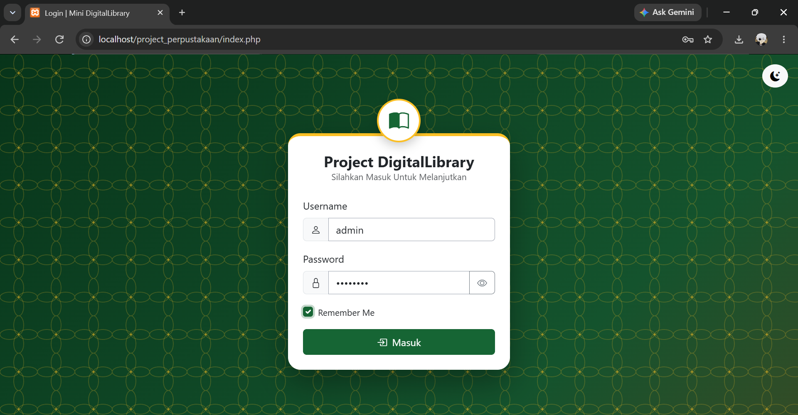
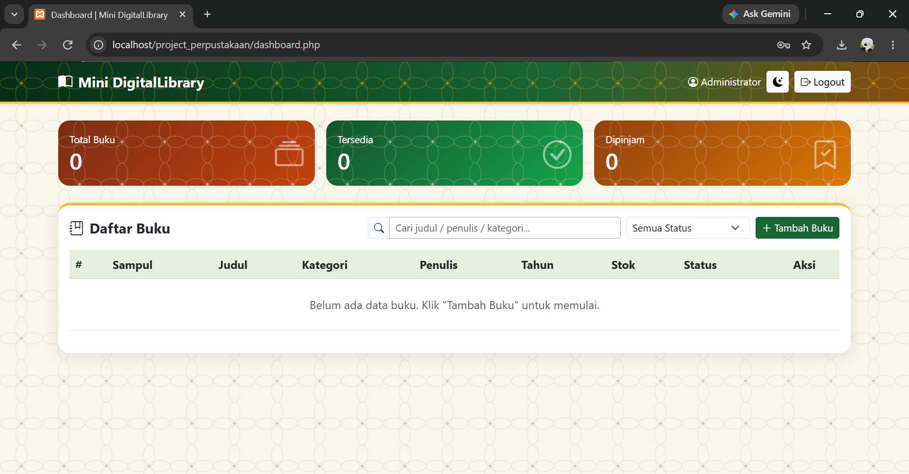
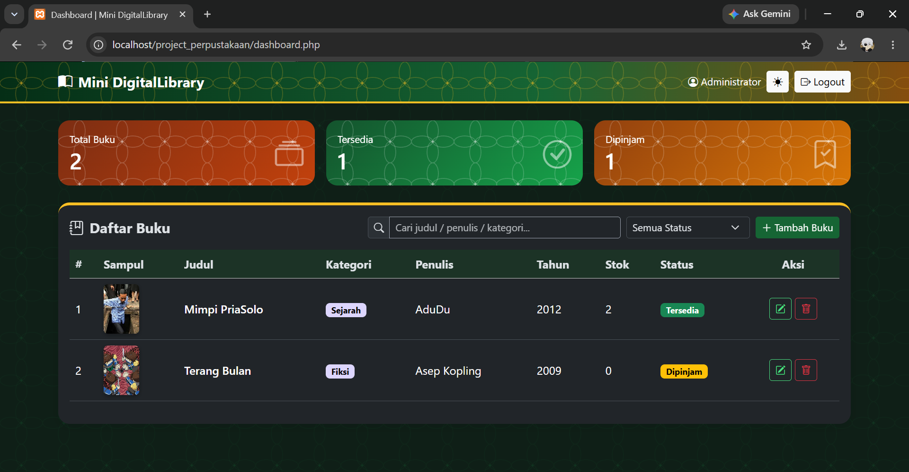
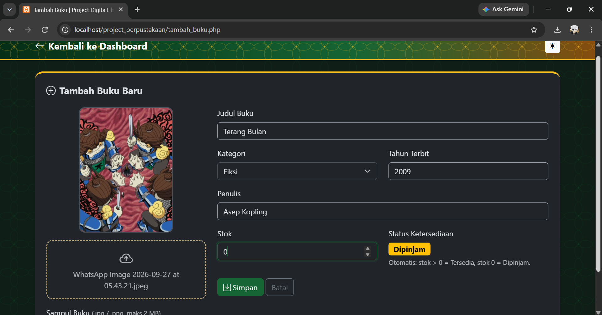
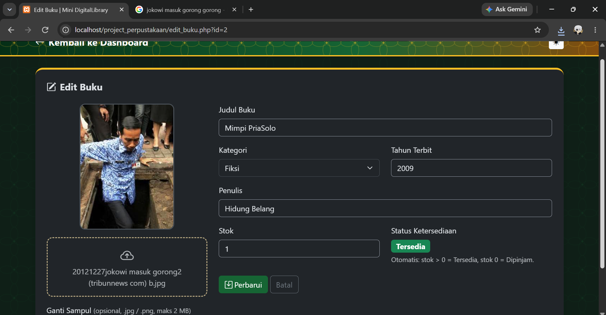

# Mini DigitalLibrary

Aplikasi web perpustakaan mini untuk mengelola data buku: login dengan session dan cookie, CRUD buku lengkap dengan upload sampul, pencarian dan filter status, serta tampilan bertema batik dengan mode terang dan gelap. Dibangun dengan **PHP Native**, **MySQL**, **Bootstrap 5**, dan JavaScript.

| | |
|---|---|
| **Nama** | Ahmad Zidane S |
| **NPM** | 2513020015 |
| **Program Studi** | Sistem Informasi, Universitas Nusantara PGRI Kediri |
| **Mata Kuliah** | Pemrograman Web |
| **Tugas** | Pengembangan Sistem Informasi Perpustakaan Digital Mini |

- **Video demo:** [isi tautan video demo]

---

## Daftar Isi

1. [Fitur](#fitur)
2. [Kesesuaian dengan Ketentuan Tugas](#kesesuaian-dengan-ketentuan-tugas)
3. [Tampilan Aplikasi](#tampilan-aplikasi)
4. [Teknologi](#teknologi)
5. [Struktur Folder](#struktur-folder)
6. [Struktur Database](#struktur-database)
7. [Alur Sistem](#alur-sistem)
8. [Keamanan](#keamanan)
9. [Instalasi](#instalasi)
10. [Akun Demo](#akun-demo)
11. [Proses Pengembangan](#proses-pengembangan)
12. [Tantangan dan Solusi](#tantangan-dan-solusi)
13. [Pengembangan Lanjutan](#pengembangan-lanjutan)
14. [Referensi dan Kredit](#referensi-dan-kredit)

---

## Fitur

**Autentikasi dan hak akses**
- Login dengan form POST, password disimpan sebagai hash (`password_hash`).
- Session membatasi akses: hanya pengguna yang sudah login yang dapat membuka dashboard dan mengelola data buku.
- "Remember Me": cookie berisi username (bukan password) selama 7 hari untuk mengisi form login berikutnya.
- Logout menghapus session dan cookie, lalu mengalihkan ke halaman login.

**Manajemen buku (CRUD)**
- Tambah, lihat, ubah, dan hapus buku.
- Upload sampul (JPG atau PNG, maksimal 2 MB) dengan pratinjau dan drag and drop.
- Mengganti sampul menghapus file lama; menghapus buku ikut menghapus file sampulnya dari folder `uploads/`.
- Status buku ditentukan otomatis dari stok: stok lebih dari 0 berstatus **Tersedia**, stok 0 berstatus **Dipinjam**.
- Kategori dipilih dari daftar tetap (array), bukan diketik bebas.

**Pencarian dan penyaringan**
- Pencarian langsung berdasarkan judul, penulis, atau kategori.
- Filter berdasarkan status ketersediaan, dengan pesan "Buku tidak ditemukan" jika hasilnya kosong.

**Tampilan**
- Tema hijau hutan, emas, dan terakota dengan motif kawung (batik) yang dibuat dengan CSS.
- Mode terang dan gelap dengan tombol ganti tema (pilihan tersimpan di `localStorage`).
- Layar pemuatan, animasi kartu dan baris tabel, angka statistik yang menghitung naik, tooltip, dan notifikasi yang hilang sendiri.
- Responsif: tabel dapat digeser di layar kecil.

---

## Kesesuaian dengan Ketentuan Tugas

| Ketentuan | Implementasi | File utama |
|---|---|---|
| Login dengan form POST | Verifikasi `password_verify`, pesan gagal login tidak membedakan username atau password | `index.php`, `proses_login.php` |
| Session | `session_start`, `session_regenerate_id`, fungsi `wajib_login()` di setiap halaman | `config/koneksi.php` |
| Cookie "Remember Me" | Cookie `remember_username`, `HttpOnly`, 7 hari | `proses_login.php` |
| Logout | Hapus session dan cookie, alihkan ke login | `logout.php` |
| Create | Form tambah buku dan insert dengan prepared statement | `tambah_buku.php`, `proses_tambah.php` |
| Read | Tabel HTML dengan pencarian dan filter | `dashboard.php` |
| Update | Ubah data dan opsi ganti sampul | `edit_buku.php`, `proses_edit.php` |
| Delete | Hapus data dari MySQL lalu hapus file dengan `unlink` | `hapus_buku.php` |
| Upload file (jpg/png, maks 2 MB) | Cek ukuran, ekstensi, dan isi file (MIME), nama file acak | fungsi `upload_sampul()` di `config/koneksi.php` |
| Percabangan label ketersediaan | `if-else` pada `tentukan_status()` dan `switch` pada `warna_status()` | `config/koneksi.php` |
| Array | `$daftar_kategori` dan `$aturan_upload` | `config/koneksi.php` |
| Validasi tipe data | `filter_var(..., FILTER_VALIDATE_INT)`, `in_array`, `trim` | `proses_tambah.php`, `proses_edit.php` |
| PHP Native tanpa framework | Tanpa framework backend | seluruh proyek |
| Koneksi `mysqli` | `mysqli_connect` dan prepared statement | `config/koneksi.php` |
| UI menarik (CSS framework dan JS) | Bootstrap 5.3, CSS kustom, JavaScript interaktif | `css/style.css`, `js/app.js` |

Struktur file mengikuti struktur yang diminta pada tugas, dengan tambahan `css/`, `js/`, dan `database.sql`.

---

## Tampilan Aplikasi

> Simpan tangkapan layar di folder `screenshots/` dengan nama berikut, atau sesuaikan nama file di bawah ini.

### Login


### Dashboard


### Dashboard (mode gelap)


### Tambah buku


### Edit buku


---

## Teknologi

| Bagian | Teknologi |
|---|---|
| Backend | PHP Native, ekstensi `mysqli` |
| Database | MySQL / MariaDB |
| Frontend | Bootstrap 5.3, Bootstrap Icons, CSS variables, JavaScript |
| Server lokal | XAMPP (Apache dan MySQL) |
| Editor | Visual Studio Code |
| Versi kontrol | Git dan GitHub |

---

## Struktur Folder

```
project_perpustakaan/
├── config/
│   └── koneksi.php        # koneksi MySQL, session, array, dan fungsi bantu
├── css/
│   └── style.css          # tema, motif kawung, mode terang/gelap
├── js/
│   └── app.js             # ganti tema, validasi form, preview gambar,
│                          #   pencarian, filter, modal hapus
├── uploads/               # folder penampung file sampul buku
│   └── .htaccess          # mencegah eksekusi script PHP di folder upload
├── index.php              # halaman login
├── proses_login.php       # verifikasi autentikasi, session, dan cookie
├── logout.php             # hapus session dan cookie
├── dashboard.php          # tampil data (Read) dan akses menu
├── tambah_buku.php        # form tambah data
├── proses_tambah.php      # query insert dan upload file
├── edit_buku.php          # form edit data
├── proses_edit.php        # query update dan penggantian file
├── hapus_buku.php         # query delete dan unlink file
├── database.sql           # skema database dan akun demo
└── README.md
```

---

## Struktur Database

Database: `db_perpustakaan` (utf8mb4).

### Tabel `users`

| Kolom | Tipe | Keterangan |
|---|---|---|
| `id` | INT, PK, AUTO_INCREMENT | |
| `username` | VARCHAR(50), UNIQUE | untuk login |
| `password` | VARCHAR(255) | hash `password_hash` |
| `nama_lengkap` | VARCHAR(100) | |

### Tabel `buku`

| Kolom | Tipe | Keterangan |
|---|---|---|
| `id` | INT, PK, AUTO_INCREMENT | |
| `judul` | VARCHAR(150) | |
| `kategori` | VARCHAR(50) | harus ada di array `$daftar_kategori` |
| `penulis` | VARCHAR(100) | |
| `tahun_terbit` | YEAR | 1901 sampai tahun sekarang |
| `stok` | INT | 0 atau lebih |
| `status` | ENUM('Tersedia','Dipinjam') | diisi otomatis dari stok |
| `sampul` | VARCHAR(255) | nama file di folder `uploads/` |
| `created_at` | TIMESTAMP | |

Kolom `status` selalu diisi oleh fungsi `tentukan_status($stok)` saat tambah dan ubah, dan dashboard menghitung ulang statusnya dari `stok` setiap ditampilkan, sehingga tidak bisa tidak sinkron dengan stok.

---

## Alur Sistem

### Login, session, dan cookie

1. Form login mengirim `username` dan `password` lewat POST ke `proses_login.php`.
2. Server mencari user dengan prepared statement, lalu mencocokkan password dengan `password_verify`.
3. Jika cocok: `session_regenerate_id(true)` mencegah session fixation, lalu data user disimpan di `$_SESSION`.
4. Jika "Remember Me" dicentang, cookie `remember_username` disimpan 7 hari dan dipakai untuk mengisi kolom username pada kunjungan berikutnya.
5. Setiap halaman yang dilindungi memanggil `wajib_login()`; tanpa session, pengguna dialihkan ke halaman login.
6. Logout mengosongkan session, menghapus cookie session dan cookie "Remember Me".

### Tambah, ubah, dan hapus buku

- **Tambah:** validasi isian dan sampul, lalu `INSERT`. Jika query gagal, file yang sudah terunggah dihapus kembali.
- **Ubah:** sampul baru (jika ada) divalidasi dan disimpan, data diperbarui, **baru setelah itu** file sampul lama dihapus. Urutan ini menjaga agar sampul lama tidak hilang jika update gagal.
- **Hapus:** hanya lewat POST dengan modal konfirmasi. Data dihapus dari database, lalu file sampulnya dihapus dengan `unlink`.

### Logika status ketersediaan

```php
function tentukan_status($stok) {
    if ((int)$stok > 0) {
        return 'Tersedia';
    } else {
        return 'Dipinjam';
    }
}
```

Warna badge ditentukan oleh `warna_status()` dengan `switch`.

---

## Keamanan

- Password disimpan dengan `password_hash` dan diperiksa dengan `password_verify`.
- Semua query memakai **prepared statement** (aman dari SQL injection).
- Semua keluaran ke HTML melewati fungsi `e()` (`htmlspecialchars`) untuk mencegah XSS.
- Upload: ukuran dibatasi 2 MB, tipe diperiksa dari **isi file** dengan `finfo` (bukan hanya ekstensi), nama file diacak, dan penghapusan file memakai `basename`.
- Folder `uploads/` memiliki `.htaccess` agar script PHP tidak bisa dijalankan dari sana.
- Operasi hapus hanya menerima metode POST.
- Validasi dilakukan ulang di server (kategori, tahun, stok), tidak hanya di browser.
- `session_regenerate_id` dipanggil setelah login berhasil.
- Cookie "Remember Me" hanya berisi username dan memakai flag `HttpOnly`.

---

## Instalasi

**Prasyarat:** XAMPP (PHP 8 atau lebih baru dengan ekstensi `mysqli` dan `fileinfo`, serta MySQL).

1. **Ambil kode**

   ```bash
   git clone https://github.com/USERNAME_KAMU/NAMA_REPO.git
   ```

   Pindahkan folder proyek ke `C:\xampp\htdocs\project_perpustakaan`.

2. **Jalankan XAMPP.** Nyalakan **Apache** dan **MySQL** di XAMPP Control Panel.

3. **Impor database.** Buka `http://localhost/phpmyadmin`, klik tab **Import**, pilih file `database.sql`, lalu klik **Go**. Ini membuat database `db_perpustakaan`, tabel `users` dan `buku`, serta akun demo.

4. **Cek konfigurasi.** Buka `config/koneksi.php` dan sesuaikan `$host`, `$user`, `$pass`, dan `$db` jika pengaturan MySQL kamu berbeda (bawaan XAMPP: `root` tanpa password).

5. **Pastikan folder `uploads/` ada** dan namanya persis `uploads` (huruf kecil, memakai "s") di dalam folder proyek.

6. **Buka aplikasi** di `http://localhost/project_perpustakaan/`.

---

## Akun Demo

| Username | Password |
|---|---|
| `admin` | `admin123` |

Ganti password akun demo sebelum aplikasi dipakai di luar keperluan belajar.

---

## Proses Pengembangan

Aplikasi dikerjakan bertahap, satu file per langkah, dan setiap langkah diuji sebelum lanjut. **Claude (Anthropic)** dipakai sebagai asisten untuk menulis draf kode dan menjelaskan fungsinya, sedangkan kebutuhan, tampilan, dan ketentuan tugas ditentukan oleh pengembang.

| Langkah | Hasil | Konsep yang dipelajari |
|---|---|---|
| 1 | Skema database `db_perpustakaan` | tabel, tipe data, `ENUM`, `YEAR` |
| 2 | `config/koneksi.php`, `css/style.css`, `js/app.js` | koneksi `mysqli`, fungsi bantu, array |
| 3 | `index.php` (halaman login) | form POST, validasi Bootstrap |
| 4 | `proses_login.php` | `password_verify`, session, cookie |
| 5 | `logout.php` | menghapus session dan cookie |
| 6 | `dashboard.php` | `SELECT`, `foreach`, `if-else`, `switch` |
| 7 | `tambah_buku.php` | `enctype="multipart/form-data"`, preview gambar |
| 8 | `proses_tambah.php` | `$_FILES`, `finfo`, prepared statement |
| 9 | `edit_buku.php` | `$_GET`, form terisi data lama |
| 10 | `proses_edit.php` | `UPDATE`, mengganti file sampul |
| 11 | `hapus_buku.php` | `DELETE`, `unlink`, POST untuk operasi data |

---

## Tantangan dan Solusi

| Masalah | Penyebab | Solusi |
|---|---|---|
| "Gagal menyimpan file ke folder uploads" | Folder dibuat dengan nama `upload` (tanpa "s"), sedangkan kode memakai `uploads` | Folder diganti namanya menjadi `uploads` |
| Label status tidak berubah saat stok diubah | Browser masih memakai `app.js` lama dari cache | Hard refresh (Ctrl + Shift + R) dan menambah `?v=2` pada link `app.js` |
| Kolom password sudah bertanda centang hijau padahal belum lengkap | Validasi bawaan Bootstrap hanya mengecek kolom tidak kosong | Validasi diganti: hanya tanda merah setelah tombol ditekan, dan password minimal 6 karakter |
| Garis tepi kolom input dan kursor sulit terlihat | Warna garis tepi bawaan terlalu pucat di latar terang | Warna garis tepi dan `caret-color` ditegaskan di CSS |
| Tahun terbit tidak bisa disimpan untuk tahun di bawah 1901 | Tipe `YEAR` di MySQL hanya menerima 1901 sampai 2155 | Batas minimum tahun di form dan validasi server diubah menjadi 1901 |
| Tampilan terlalu mirip tema bawaan Bootstrap | Warna dominan biru bawaan Bootstrap | Seluruh warna dan variabel Bootstrap diganti, dan ditambah motif kawung dengan CSS |

---

## Pengembangan Lanjutan

Belum dikerjakan karena di luar ruang lingkup tugas:

- Token CSRF pada setiap form.
- Pembatasan percobaan login (rate limiting).
- Pagination untuk koleksi buku yang besar.
- Fitur peminjaman sungguhan (saat ini status hanya mengikuti stok).
- Pembagian peran admin dan pengunjung.
- Manajemen pengguna, profil, dan lupa password.

---

## Referensi dan Kredit

- **Spesifikasi tugas:** Pengembangan Sistem Informasi Perpustakaan Digital Mini.
- **Asisten pengembangan:** Claude (Anthropic).
- **Pustaka:** [Bootstrap 5.3](https://getbootstrap.com/) dan [Bootstrap Icons](https://icons.getbootstrap.com/), dimuat dari CDN.
- **Sampul buku** pada data contoh adalah milik penerbit dan penulis masing-masing, dipakai hanya sebagai contoh untuk keperluan akademik nonkomersial.
